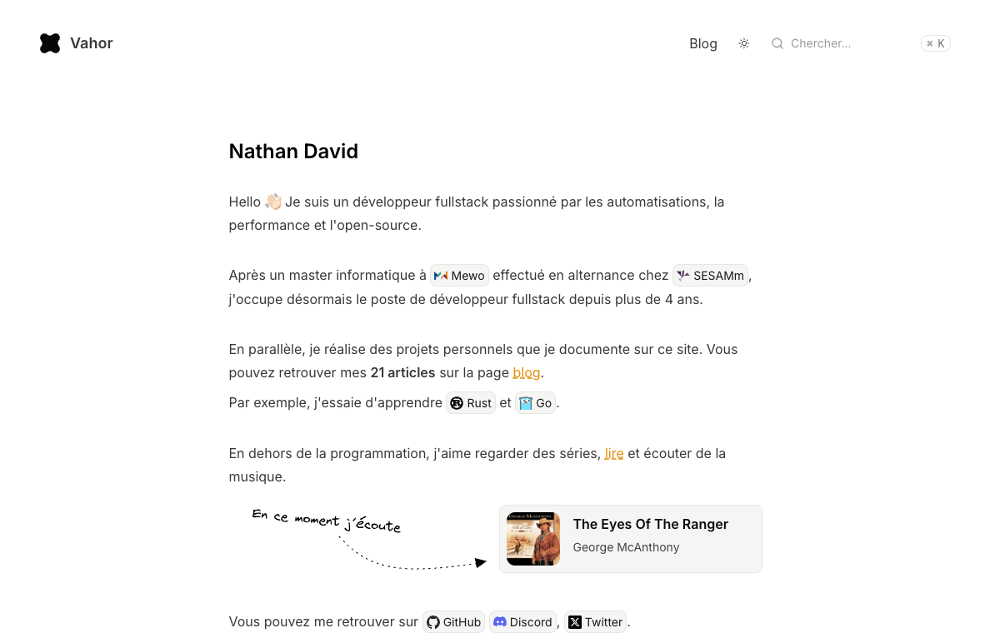

# vahor.fr

My portfolio and writing, built with Astro.

[](https://github.com/vahor-labs/vahor.fr/actions/workflows/quality.yaml)
[](LICENSE)

[Visit vahor.fr](https://vahor.fr) · [Quick start](#quick-start) · [Container](#container) · [Contributing](CONTRIBUTING.md)



- MDX articles, RSS and Markdown exports.
- On-demand search. No React runtime.
- Optional Spotify listening activity.

## Quick start

Use Node 26 and Bun:

```sh
bun install --frozen-lockfile
bun dev
```

No secrets needed for local builds.

## Stack

| Area | Implementation |
| --- | --- |
| Pages and articles | Astro + MDX; mostly static |
| Search | Fuse, loaded on demand |
| Feeds | RSS at `/rss.xml`, sitemap at `/sitemap-index.xml` |
| Images | Astro image processing and build-time social cards |
| Runtime | Node standalone server |

## Container

```sh
docker build -t vahor-fr .
docker run --rm -p 4321:4321 --env-file .env.production.local vahor-fr
```

Pass integration variables at runtime. Omit `--env-file` to run without them.

## Integrations

| Integration | Configuration |
| --- | --- |
| Spotify | `SPOTIFY_CLIENT_ID` and `SPOTIFY_CLIENT_SECRET` |
| Redis | `UPSTASH_REDIS_REST_URL` and `UPSTASH_REDIS_REST_TOKEN` (or `KV_REST_API_URL` and `KV_REST_API_TOKEN`) |
| Comments | Giscus |
| URL previews | Build-time metadata; optional Redis cache |

For Spotify:

1. Authorize the same Spotify app with `user-top-read`.
2. Store the refresh token as `spotify:refreshToken` in Redis, without expiry.
3. Set the Spotify and Redis variables above.

macOS authorization helper: [`scripts/spotify.sh`](scripts/spotify.sh).

- No Spotify track? The listening block stays hidden.
- Keep secrets out of Git, logs and `PUBLIC_` variables.
- URL previews need network access during builds.

## Contributing

[Contribution guide](CONTRIBUTING.md) · [Report a bug or request a feature](https://github.com/vahor-labs/vahor.fr/issues/new/choose)

## License

[MIT](LICENSE).
